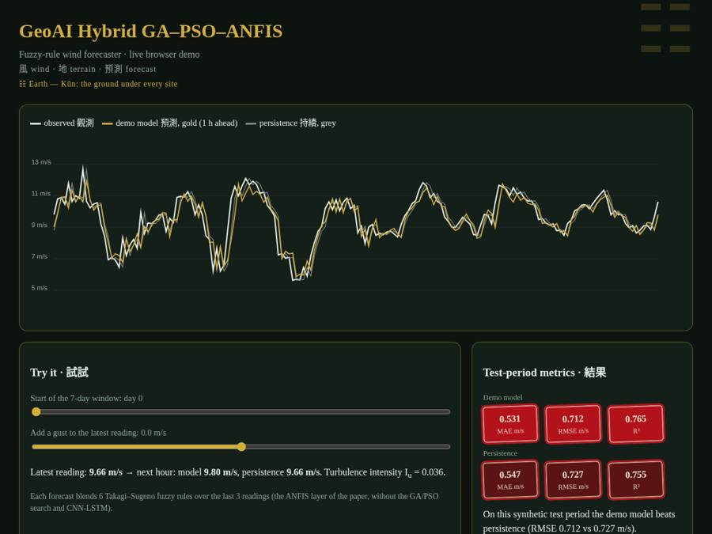

# GeoAI hybrid: GA → PSO → ANFIS → CNN-LSTM probabilistic multi-site wind forecasting

*風 wind · 地 terrain · 預測 forecast*

[](https://rishabh-bgp.github.io/geoai-hybrid-ga-pso-anfis-wind-forecasting/) [](https://colab.research.google.com/github/Rishabh-bgp/geoai-hybrid-ga-pso-anfis-wind-forecasting/blob/main/notebooks/walkthrough.ipynb) [](https://github.com/Rishabh-bgp/geoai-hybrid-ga-pso-anfis-wind-forecasting/actions/workflows/ci.yml) [](LICENSE)  

[](https://rishabh-bgp.github.io/geoai-hybrid-ga-pso-anfis-wind-forecasting/)

**GeoAI hybrid GA–PSO–ANFIS–CNN-LSTM** is the reference implementation of my paper on a probabilistic, multi-site **wind speed forecasting** method: a genetic algorithm (GA) picks the network architecture, particle swarm optimization (PSO) tunes the learning rate and dropout, an ANFIS fuzzy layer encodes the inputs, and a CNN-LSTM predicts quantiles with Monte-Carlo dropout for uncertainty. The paper proposes combining geospatial site features with a two-level metaheuristic search (GA then PSO) around an ANFIS → CNN-LSTM quantile network, so that forecasts for many wind sites come with calibrated uncertainty (pinball loss, CRPS, interval coverage).

**Try it:** [live demo](https://rishabh-bgp.github.io/geoai-hybrid-ga-pso-anfis-wind-forecasting/) · [notebook in Colab](https://colab.research.google.com/github/Rishabh-bgp/geoai-hybrid-ga-pso-anfis-wind-forecasting/blob/main/notebooks/walkthrough.ipynb)

## Live demo

The [live demo](https://rishabh-bgp.github.io/geoai-hybrid-ga-pso-anfis-wind-forecasting/) runs a small version of the model directly in your browser. It shows one week of synthetic wind speed, the model's next-hour forecast (gold) and the persistence forecast (grey). Use the sliders to move through the test period or add a gust to the latest reading, and the forecast updates. The metrics are shown as red seal-style badges.

**About the design.** The look borrows from Chinese ink painting: dark paper, gold lines, crimson seals. Each repository has its own trigram from the I Ching and its own seal stamp. This one uses ☷ 坤 Kūn, Earth, which stands for the ground and terrain that the geospatial site features describe. Across the series, 風 means wind and 預測 means forecast; the trigram for wind itself is ☴ 巽 Xùn. The motifs are decoration only and play no part in the method.

## Architecture · 架構

The five layers are:
1. **Genetic algorithm** over architecture genes (CNN filters, LSTM hidden size, number of ANFIS rules), using elitism, uniform crossover and mutation.
2. **Particle swarm optimization** over continuous genes (log learning rate, dropout).
3. **ANFIS:** first-order TSK with Gaussian membership functions. Normalized rule firing strengths and rule outputs are appended as features.
4. **CNN-LSTM core:** two Conv1D blocks → 2-layer LSTM, plus a static site embedding (lat, lon, elevation) and Monte Carlo dropout at inference.
5. **Quantile head:** τ = 0.05, 0.25, 0.5, 0.75 and 0.95, kept monotone, trained with pinball loss.

The model takes all sites' history and predicts the target site at multiple horizons. For each horizon it reports MAE, RMSE, MAPE and R² of the median, the CRPS (quantile approximation), the 90% interval coverage, a coarse PIT histogram and the persistence RMSE.

## Quick start

```bash
python -m venv .venv && source .venv/bin/activate   # Windows: .venv\Scripts\activate
pip install -r requirements.txt
python -m src.train_eval                       # default horizons 1,6,24 h
python -m src.train_eval --quick
python -m src.train_eval --csv sites.csv --horizons 1,6,24,72,168
```

Outputs: `results/results.json` (config, GA/PSO log, per-horizon metrics).

Run the tests with `pytest -q`. They include a check that the browser demo's JavaScript gives the same predictions as Python (uses `node` if it is installed).

## Notebook for examiners

[](https://colab.research.google.com/github/Rishabh-bgp/geoai-hybrid-ga-pso-anfis-wind-forecasting/blob/main/notebooks/walkthrough.ipynb)

`notebooks/walkthrough.ipynb` is a simplified, step-by-step version of the method, with all its code inside the notebook. It is saved with its outputs, so you can read it without running anything.

To run it yourself:
1. Click **Open in Colab** above (or open the file in Anaconda Jupyter).
2. Choose **Runtime → Run all** (in Jupyter: **Run → Run All Cells**).
3. Wait about a minute on a normal CPU. All the code is inside the notebook, so it runs on its own; it fetches the synthetic CSV from this repository (or regenerates it) if the file is not next to it.
4. Read the printed table: the model's errors next to the *persistence* forecast ("next hour = this hour"). Lower MAE/RMSE and higher R² are better.

## Data · 數據

- **`data/synthetic/synthetic_sites.csv` is synthetic.** It was generated by the seeded script `scripts/make_synthetic.py`
  (seed 0; 6 synthetic sites × 60 days hourly, spatially correlated through a shared lagged signal, with lat/lon/elevation). It contains no real measurements and exists so the code runs out of the box.
- The original SCADA data is confidential and is **not** included.
- Everything in `data/` except the synthetic CSV is git-ignored, so you can drop your own CSV there safely.
- To use your own data: pass `--csv sites.csv` in long format with columns `timestamp,site,lat,lon,elevation,wind_speed`.
- Regenerate the synthetic file: `python scripts/make_synthetic.py`

## Results vs persistence · 結果

These are the real numbers from this repository on **synthetic** data. They are not the paper's results and cannot be compared with them.
Both models predict the change from the last reading and are compared with persistence, the standard baseline for short-term wind forecasting.

| Model | MAE (m/s) | RMSE (m/s) | R² |
|---|---|---|---|
| Notebook model (1h ahead) | 0.495 | 0.666 | 0.838 |
| Persistence (1h ahead) | 0.538 | 0.729 | 0.806 |
| Notebook model (6h ahead) | 1.261 | 1.557 | 0.110 |
| Persistence (6h ahead) | 1.753 | 2.170 | -0.728 |
| Browser demo model | 0.531 | 0.712 | 0.765 |
| Persistence (demo test period) | 0.547 | 0.727 | 0.755 |

In this short demo the model beats persistence on every row above. The browser demo uses a smaller model (re-implemented in JavaScript); `python scripts/build_demo.py` rebuilds it.

MAE, RMSE (m/s), MAPE (%, computed only where observed wind speed ≥ 0.5 m/s to avoid division by near-zero) and R².

## About this implementation

> **Reference implementation of my paper**, rebuilt in Python on synthetic data because the original SCADA data is confidential. Results will differ from the published numbers, and nothing here claims to reproduce them.

- Data: the paper uses 736,416 hourly ERA5, MERRA-2, NASA POWER and WRF observations at 12 African sites, with SRTM and land-cover layers. Here a 6-site synthetic, spatially correlated set is used. A multi-site CSV loader (`timestamp,site,lat,lon,elevation,wind_speed`) is provided for real data.
- Model size: three conv blocks (32, 64, 128) and three LSTM layers in the paper become two of each here. The 2-D 3×3 convolutions become 1-D.
- Search budget: the paper's PSO uses 40 particles × 50 iterations; the defaults here are tiny (GA 6×3, PSO 4×3).
- Not implemented: the Lyapunov-stability analysis and the capacity-factor/World Bank uplift analysis.

## Citation · 論文引用

Er. Rishabh Aryan and Prof. Dr. Tryambak Hiwarkar (2026). "A Unified GeoAI Hybrid Framework for African Windscapes: Integrating Evolutionary Swarm, Fuzzy-Neuro Computing, and Probabilistic Spatio-Temporal Wind Forecasting for Sustainable Regional Energy Planning." *African Journal of Geography and Regional Planning (AJGRP)*.

## License

MIT © 2026 Rishabh Aryan. See [LICENSE](LICENSE). The paper itself is not included.


## M.Tech in AI and Data Science, IIIT Bhagalpur: Thesis Work

Wind power forecasting reference implementations from my M.Tech thesis work at IIIT Bhagalpur, grouped by method.

### Quantum and hybrid quantum machine learning

| | Repository | Approach | Live |
|:---:|---|---|---|
| `08 ☰ 乾 Qian` | [hybrid-vqc-wind-speed-forecasting](https://github.com/Rishabh-bgp/hybrid-vqc-wind-speed-forecasting) | Hybrid variational quantum circuit (Conv1D-LSTM + VQC), PyTorch + PennyLane | [demo](https://rishabh-bgp.github.io/hybrid-vqc-wind-speed-forecasting/) |
| `10 ☵ 坎 Kan` | [cbma-tn-vqc-wind-green-hydrogen](https://github.com/Rishabh-bgp/cbma-tn-vqc-wind-green-hydrogen) | CNN-BiLSTM-MultiHead attention + tensor-network VQC, wind forecasting for green hydrogen | [demo](https://rishabh-bgp.github.io/cbma-tn-vqc-wind-green-hydrogen/) |
| `12 ☶ 艮 Gen` | [hcq-lstm-clqgwo-wind-forecasting](https://github.com/Rishabh-bgp/hcq-lstm-clqgwo-wind-forecasting) | Physics-informed hybrid classical-quantum LSTM tuned by a chaotic Lévy-flight quantum-inspired grey wolf optimizer | [demo](https://rishabh-bgp.github.io/hcq-lstm-clqgwo-wind-forecasting/) |

### Metaheuristic-optimized hybrids

| | Repository | Approach | Live |
|:---:|---|---|---|
| `04 ☷ 坤 Kun` | **geoai-hybrid-ga-pso-anfis-wind-forecasting** (this repo) | GeoAI hybrid: GA → PSO → ANFIS → CNN-LSTM probabilistic multi-site forecasting | [demo](https://rishabh-bgp.github.io/geoai-hybrid-ga-pso-anfis-wind-forecasting/) |

### Deep learning with attention and gating

| | Repository | Approach | Live |
|:---:|---|---|---|
| `05 ☲ 離 Li` | [xai-shap-lime-cnn-bilstm-attention-wind](https://github.com/Rishabh-bgp/xai-shap-lime-cnn-bilstm-attention-wind) | Explainable CNN-BiLSTM-Attention forecasting with SHAP and LIME | [demo](https://rishabh-bgp.github.io/xai-shap-lime-cnn-bilstm-attention-wind/) |
| `09+13 ☵ 坎 Kan` | [wuweidl-daoist-gated-wind-forecasting](https://github.com/Rishabh-bgp/wuweidl-daoist-gated-wind-forecasting) | WuWeiDL: Wu Wei gating and Feng-Qi turbulence encoding | [demo](https://rishabh-bgp.github.io/wuweidl-daoist-gated-wind-forecasting/) |
| `16 ☴ 巽 Xun` | [rso-net-wind-grid-stabilization](https://github.com/Rishabh-bgp/rso-net-wind-grid-stabilization) | RSO-Net: recursive self-optimizing TCN-Attention probabilistic forecasting with grid-stabilization proposals | [demo](https://rishabh-bgp.github.io/rso-net-wind-grid-stabilization/) |

### IoT, automation and multi-agent systems

| | Repository | Approach | Live |
|:---:|---|---|---|
| `14 ☳ 震 Zhen` | [iot-n8n-wind-turbine-predictive-maintenance](https://github.com/Rishabh-bgp/iot-n8n-wind-turbine-predictive-maintenance) | IoT + forecasting + n8n automation for wind-turbine predictive maintenance | [demo](https://rishabh-bgp.github.io/iot-n8n-wind-turbine-predictive-maintenance/) |
| `15 ☱ 兌 Dui` | [multi-agent-turbine-fleet-chief-of-staff](https://github.com/Rishabh-bgp/multi-agent-turbine-fleet-chief-of-staff) | Multi-agent AI chief of staff for wind-turbine fleet operations | [demo](https://rishabh-bgp.github.io/multi-agent-turbine-fleet-chief-of-staff/) |

<!-- THESIS-PLACEHOLDER: add further thesis repos as rows in the matching group, ordered by paper number. -->

## Other repositories by Rishabh Aryan

- [xai-shap-lime-cnn-bilstm-attention-wind](https://github.com/Rishabh-bgp/xai-shap-lime-cnn-bilstm-attention-wind)
- [wuweidl-daoist-gated-wind-forecasting](https://github.com/Rishabh-bgp/wuweidl-daoist-gated-wind-forecasting)
- [iot-n8n-wind-turbine-predictive-maintenance](https://github.com/Rishabh-bgp/iot-n8n-wind-turbine-predictive-maintenance)
- [multi-agent-turbine-fleet-chief-of-staff](https://github.com/Rishabh-bgp/multi-agent-turbine-fleet-chief-of-staff)
